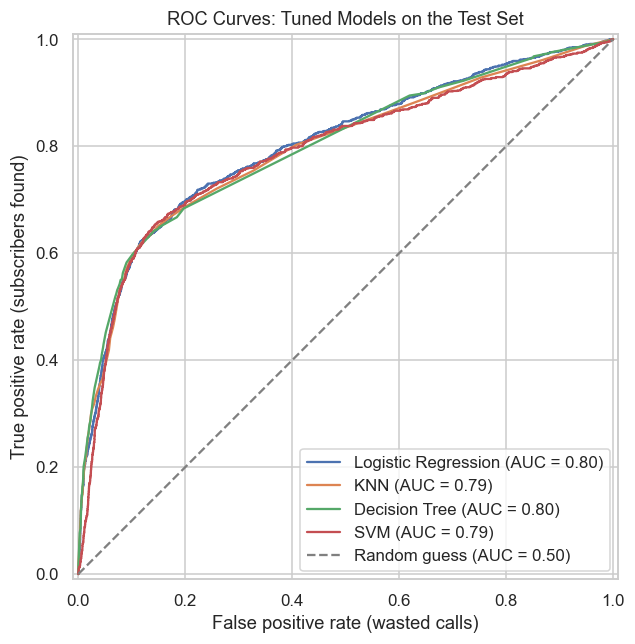
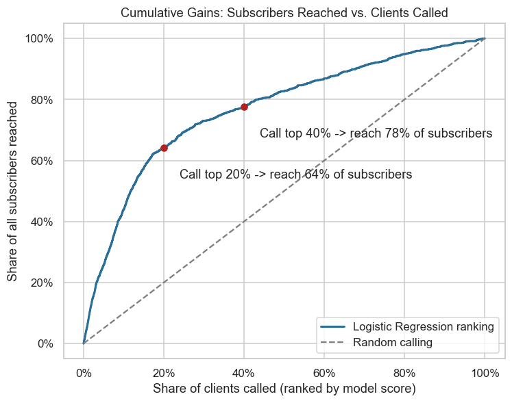
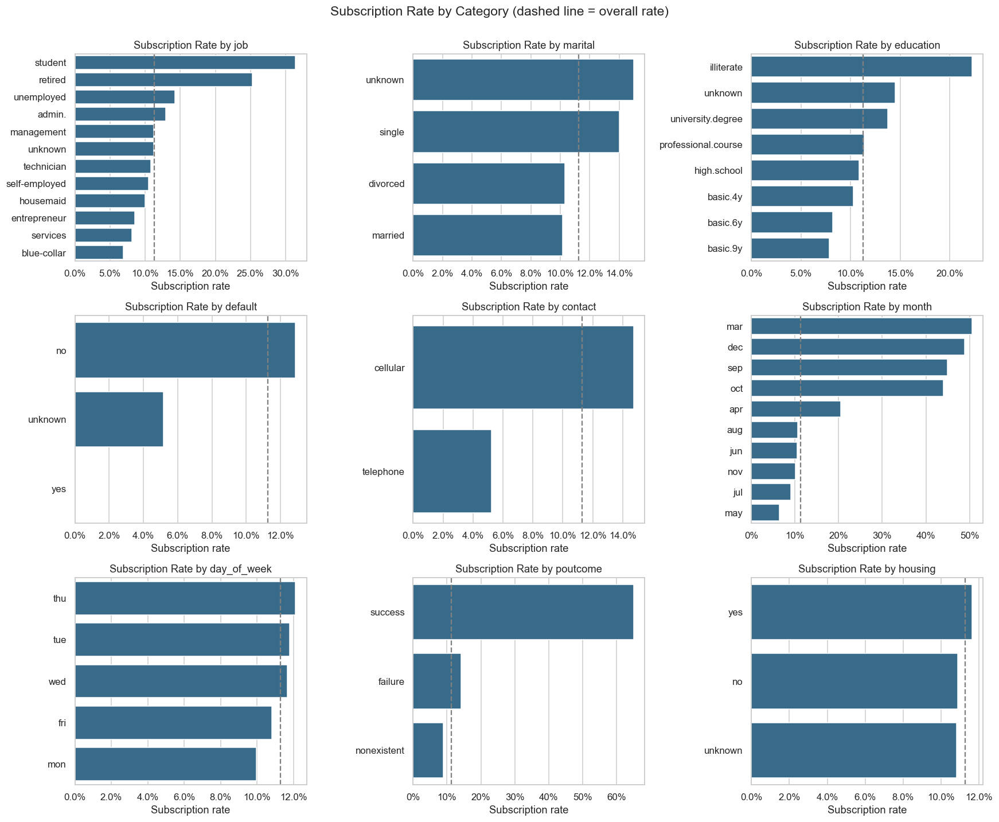

# Who Will Say Yes to a Term Deposit? Comparing Classifiers

A comparison of four machine learning classifiers: k-nearest neighbors, logistic regression, decision tree and support vector machine. They are used to predict which bank clients will subscribe to a term deposit after a marketing phone call, so the bank can focus its calls on the clients most likely to say yes.

**Full analysis:** [`prompt_III.ipynb`](prompt_III.ipynb)

## The Question

A Portuguese bank sells term deposits through outbound phone campaigns. Most calls fail: only about **1 in 9 clients subscribes**. Each unsuccessful call costs agent time and can annoy customers.

This project asks: **using only information available before dialing, can we predict which clients will subscribe, and which model does it best?** With good predictions, the bank can rank its client list and spend its calling budget on the most promising clients.

## The Data

The data comes from the [UCI Machine Learning Repository](https://archive.ics.uci.edu/dataset/222/bank+marketing) and the accompanying paper by Moro et al. ([`CRISP-DM-BANK.pdf`](CRISP-DM-BANK.pdf)). It covers **17 phone campaigns between May 2008 and November 2010**. That is 41,188 contacts, each described by:

- client profile (age, job, marital status, education, credit default, loans)
- contact details (phone type, month, day, number of calls)
- previous-campaign history
- five economic indicators (for example the Euribor interest rate and the employment variation rate)

Only **11.3%** of contacts led to a subscription, so the classes are heavily imbalanced.

Data cleaning:
- 12 duplicate rows were removed.
- `'unknown'` values were kept as their own category.
- The `pdays = 999` placeholder was replaced with a "previously contacted" flag.
- Call `duration` was removed because it is only known *after* the call and would leak the answer.

## How the Models Were Judged

Accuracy is misleading here. A "model" that predicts *nobody subscribes* is **88.7% accurate** and finds zero customers. I used **ROC-AUC** as the main metric because it measures how well a model **ranks** likely subscribers above unlikely ones, which is exactly what a call list needs. Recall (share of subscribers reached) and precision (share of calls that succeed) are reported alongside it.

Every model was tuned with **grid search** and **5-fold stratified cross-validation**.

## Key Findings

### Model comparison

| Model | Test ROC-AUC | Subscribers found (recall) | Calls that succeed (precision) | Verdict |
|---|---|---|---|---|
| **Logistic Regression** | **0.802** | **64%** | 36% | Best ranking, fastest, easy to explain. **Recommended** |
| Decision Tree | 0.798 | 26% | 64% | Close second, produces simple rules |
| KNN | 0.795 | 21% | 68% | Good ranking but slow to predict at scale |
| SVM | 0.790 | 64% | 38% | Slowest to train, no extra benefit |

With default settings and only the basic client-profile features, **no model beat the "always say no" baseline**: test ROC-AUC was only 0.58-0.65. Adding contact, campaign-history and economic features raised every model to **~0.80**. Choosing the right features mattered far more than choosing the algorithm.



### Calling the model's top picks is 3-4× more efficient than calling at random

| Share of clients called | Share of all subscribers reached | Success rate per call |
|---|---|---|
| Top 10% | 44% | ~50% |
| Top 20% | 64% | ~36% |
| Top 40% | 78% | ~22% |
| Random calling (any share) | same as share called | ~11% |



### What drives a "yes"

- **A previous yes is the best predictor.** 65% of clients who accepted a previous campaign subscribed again, versus under 9% of clients never contacted before.
- **Mobile beats landline.** Cell-phone contacts subscribed at 14.7% vs. 5.2% for landlines. In the model, a cell-phone client has about 1.8× the odds of subscribing, all else being equal.
- **Students and retirees respond best** (31% and 25%). Blue-collar and services workers respond least.
- **More calls do not help.** Success falls from 13% on the first call to about 5% after six or more calls in the same campaign.
- **The economy matters.** When the Euribor rate was under 2%, 24.5% of contacts subscribed. At 4% or higher, only 4.8% did.
- **What doesn't matter:** having a housing or personal loan, and the day of the week, made little or no difference.



## Recommendations

1. **Score every client with the logistic regression model before each campaign and call in score order.** Choose a cut-off (for example, the top 20-30%) that matches call-center capacity.
2. **Prioritize previous successful customers and mobile numbers**, and collect mobile numbers where they are missing.
3. **Cap repeat calls** at about 3 per client per campaign, and spend the freed-up time on new high-scoring clients.
4. **Tailor scripts** for the best-responding segments: retirees (security and income) and students (first savings product).
5. **Plan campaign size around economic conditions.** Expect higher conversion when interest rates are low.

## Next Steps

- Set the call cut-off from real costs: the cost per call vs. the value of a deposit.
- Try ensemble models (random forest, gradient boosting) and probability calibration.
- Validate on later campaigns (a time-based split) to confirm the model holds up as the economy changes.
- Run an A/B pilot comparing model-ranked calling with the current approach.
- Review fairness, since personal attributes such as age and marital status influence predictions.

## Repository Contents

- [`prompt_III.ipynb`](prompt_III.ipynb): the full analysis, covering data cleaning, exploratory visualizations, statistical tests, modeling, grid search, model comparison and findings.
- [`data/`](data): the UCI bank marketing dataset (`bank-additional-full.csv` is used; `bank-additional-names.txt` describes the fields).
- [`images/`](images): key figures generated by the notebook.
- [`CRISP-DM-BANK.pdf`](CRISP-DM-BANK.pdf): the research paper that accompanies the dataset.

## Running the Analysis

```bash
pip install pandas numpy scipy matplotlib seaborn scikit-learn jupyter
jupyter notebook prompt_III.ipynb
```
